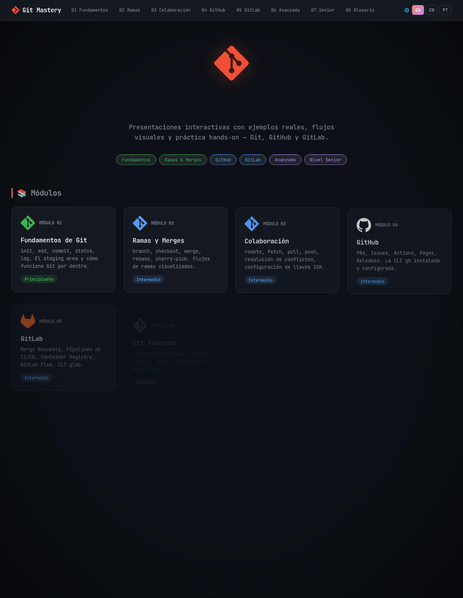

# Git Mastery — De Cero a Senior

Curso interactivo de Git en formato de diapositivas, de los fundamentos hasta nivel senior.

🔗 **Ver en línea:** https://jdswe.github.io/git-mastery/

## Contenido

1. [Fundamentos](01-fundamentos.html)
2. [Ramas y Merges](02-ramas.html)
3. [Colaboración](03-colaboracion.html)
4. [GitHub](04-github.html)
5. [GitLab](05-gitlab.html)
6. [Git Avanzado](06-avanzado.html)
7. [Nivel Senior](07-senior.html)
8. [Glosario de Comandos](08-glosario.html)

## Tecnologías

HTML, CSS y JavaScript sin dependencias ni build. Solo abre `index.html` o visita el sitio publicado en GitHub Pages.
